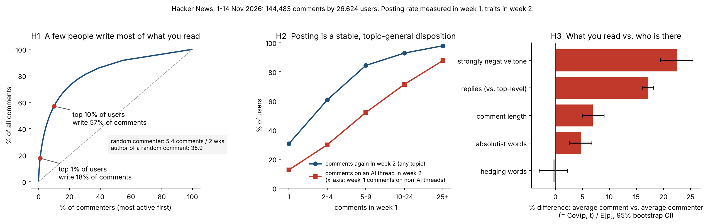

# Participation bias in public discourse

[One-page write-up](writeup.md) · [X corpus and sampling methods](x_corpus/README.md) · [Thread breadth comparison](breadth_experiment/results.json)

Code and figures for a short write-up on the question: people who participate in public discourse tend to be
the kind of people who tend to participate. What does this explain, and how would you model it?

**Model.** Each person has a posting rate p and a trait t. A reader samples posts, not people, so

    mean of t over posts = E[p*t]/E[p] = E[t] + Cov(p, t)/E[p]

**Data.** Every Hacker News comment from 1-14 Nov 2026 (144,483 comments, 26,624 users), from the public Algolia HN API.
Posting rate is measured in week 1, text traits in week 2. Hypotheses were fixed before looking at the data.

**Simulation.** Expertise and conviction are independent in the population; a person posts if
expertise + conviction + noise passes a threshold. Among posters the two become negatively correlated (collider bias).

## Run

    pip install -r requirements.txt
    python3 fetch.py data               # downloads the comments (about 1 minute, 180 MB)
    python3 analyze.py data results     # H1-H3 -> results/results.json
    python3 robust_fig.py data results  # robustness checks and the figure
    python3 collider_sim.py results     # collider simulation

Optional: `python3 llm_rate.py data results .env <model>` rates 1,500 comments for hostility and assertiveness with an
LLM, blind to author (needs `OPENAI_API_KEY` in `.env`, see `.env.example`).

## LLM-rated checks (gpt-5.4-mini, blind to author)

- Tone (`llm_rate.py`, 1,500 comments): share rated dismissive or hostile rises from 6% (no week-1 comments) to 19% (25+ week-1 comments). Results: `results/llm_validation.json`.
- Stance on AI (`stance_rate.py`, 1,800 comments on AI threads, -3 to 3, two judges: gpt-5.4-mini and gpt-4.1).
  The judges agree well where both see a stance (n = 1,247: Spearman 0.80, same sign in 92% of non-neutral cases).
  gpt-5.4-mini mostly scores no-view comments as 0 (37% zeros, 10% null); gpt-4.1 uses null more (21% zeros, 30% null).
  - Pre-stated hypothesis, heavy posters are more extreme: not supported. Spearman rho of posting-rate bin vs |stance| is
    0.00 (gpt-5.4-mini), 0.06 (gpt-4.1, p = 0.04), 0.03 (mean of both judges, p = 0.23).
  - Exploratory: heavy posters are more sceptical under both judges. Mean stance from lightest to heaviest bin:
    0.03 to -0.47 (gpt-5.4-mini, first run), -0.11 to -0.74 (gpt-4.1), -0.05 to -0.62 (mean of both, rho = -0.15).
  - Results: `results/stance*.json`; every rating: `results/stance_ratings_*.json`.

## X sample (SinclairSchneider/tweets_sample_2026 on Hugging Face)

A keyword-collected corpus, not a random sample of X. Full-corpus counts and the account-weighting analysis are in `x_corpus/`
(see its README). `x_llm.py` is a separate LLM-rated test on three shards (gpt-4.1, 400 accounts per posting-rate bin,
hypotheses written in the script before running). Results: `results/x_llm_gpt-4.1.json`.

- X1, heavy accounts are less often individual people: supported. Organisations and automated accounts rise from 8% (no posts
  captured in Jan-Apr) to 38% (26+ captured posts).
- X2, among individuals hostility rises with posting rate: not supported (Spearman rho = -0.01, p = 0.74).
- X3, among individuals posting about politics, stance extremity rises with posting rate: not supported (rho = -0.05, p = 0.05).

Posting-rate bins come from three of 73 shards, so they are thinned counts. Raw posts, handles and per-post ratings are not in this repo.

## Limits

Lurkers are invisible, so true concentration is larger. Word-list and VADER traits are crude; LLM ratings are not human-validated.
Neither sample is the population.
