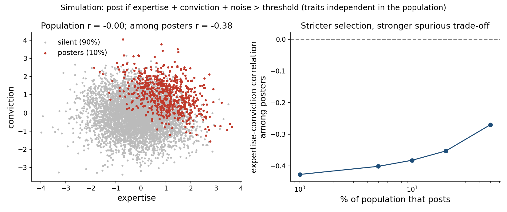

# Participation bias in public discourse

Code and figures for a short write-up on the question: people who participate in public discourse tend to be
the kind of people who tend to participate. What does this explain, and how would you model it?

**Model.** Each person has a posting rate p and a trait t. A reader samples posts, not people, so

    mean of t over posts = E[p*t]/E[p] = E[t] + Cov(p, t)/E[p]

**Data.** Every Hacker News comment from 1-14 Nov 2026 (144,483 comments, 26,624 users), from the public Algolia HN API.
Posting rate is measured in week 1, text traits in week 2. Hypotheses were fixed before looking at the data.

**Simulation.** Expertise and conviction are independent in the population; a person posts if
expertise + conviction + noise passes a threshold. Among posters the two become negatively correlated (collider bias).

## Run

    pip install -r requirements.txt
    python3 fetch.py data               # downloads the comments (about 1 minute, 180 MB)
    python3 analyze.py data results     # H1-H3 -> results/results.json
    python3 robust_fig.py data results  # robustness checks and the figure
    python3 collider_sim.py results     # collider simulation

Optional: `python3 llm_rate.py data results .env <model>` rates 1,500 comments for hostility and assertiveness with an
LLM, blind to author (needs `OPENAI_API_KEY` in `.env`, see `.env.example`).

## LLM-rated checks (gpt-5.4-mini, blind to author)

- Tone (`llm_rate.py`, 1,500 comments): share rated dismissive or hostile rises from 6% (no week-1 comments) to 19% (25+ week-1 comments). Results: `results/llm_validation.json`.
- Stance on AI (`stance_rate.py`, 1,800 comments on AI threads, -3 to 3): the pre-stated hypothesis that heavy posters are more extreme was not supported (Spearman rho = -0.01 for |stance|). Exploratory: heavy posters are more sceptical (mean stance 0.03 to -0.47). Results: `results/stance.json`.

## Limits

Lurkers are invisible, so true concentration is larger. Word-list and VADER traits are crude; LLM ratings are not human-validated.
Hacker News is not X.
