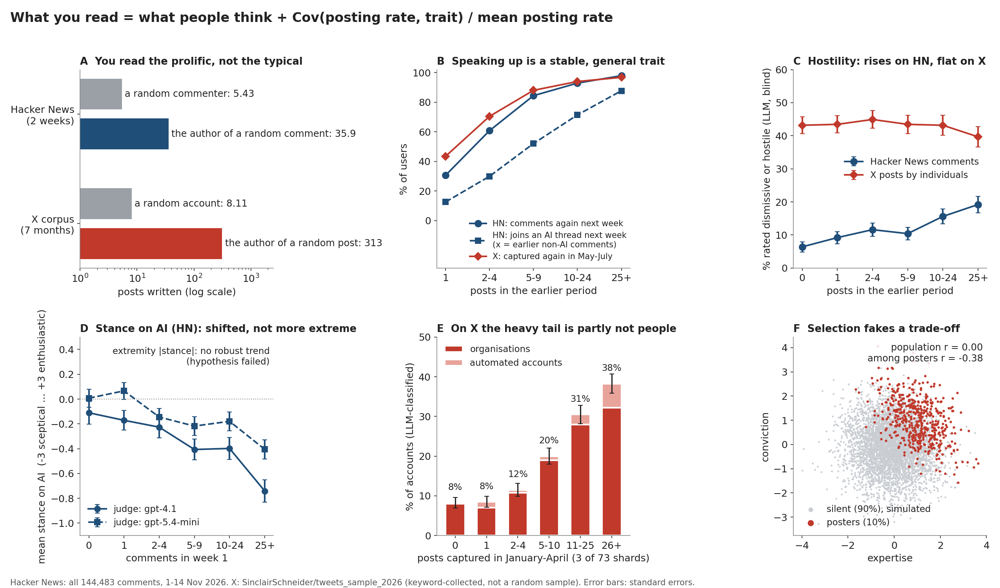

# Participation bias in public discourse

Question: in public discourse, people who participate tend to be the kind of people who tend to participate.
What (if anything) does this explain, and how would you model it?

The one-page answer is in [`writeup.md`](writeup.md). This repository holds the evidence behind it.

## Model

Each person has a posting rate p and a trait t. A reader samples posts, not people, so

    mean of t over posts = E[p*t]/E[p] = E[t] + Cov(p, t)/E[p]

With t = p this is size-biased sampling: the author of a random post posts at E[p] + Var(p)/E[p].
For any other trait the gap is a covariance that has to be measured.

## Results

Hypotheses were written down before each analysis. Failed predictions are reported as failed.

**Hacker News** - every comment from 1-14 Nov 2026 (144,483 comments, 26,624 users). Rate from week 1, traits from week 2.

| Claim | Result |
|---|---|
| Posting is concentrated | Supported. A random commenter wrote 5.4 comments, the author of a random comment 35.9. Top 10% wrote 57%. |
| Posting is a stable, topic-general disposition | Supported. Commenting again in week 2: 31% (1 comment in week 1) to 98% (25+). Joining an AI thread, by earlier non-AI activity: 13% to 88%. |
| ...but situation matters too | Users with exactly two comments spread them over both weeks 31% of the time (50% by chance). |
| Heavy posters reply more | Supported. Replies are 77% of comments, 66% for the average commenter. |
| Heavy posters hedge less | Not supported (0.73 vs 0.73 hedging words per 100). |
| Heavy posters are more hostile | Supported (LLM-rated, blind to author, 1,500 comments): 6% to 19% rated dismissive or hostile. |
| Heavy posters hold more extreme views on AI | Not supported (two LLM judges, 1,800 comments; no robust trend in distance from neutral). |
| Exploratory: heavy posters are more AI-sceptical | Mean stance -0.11 to -0.74 (gpt-4.1) and 0.01 to -0.41 (gpt-5.4-mini) on a -3 to 3 scale. |

**X** - [SinclairSchneider/tweets_sample_2026](https://huggingface.co/datasets/SinclairSchneider/tweets_sample_2026), a keyword-collected corpus. It is not a random sample of X.

| Claim | Result |
|---|---|
| Same disposition | Full corpus (72M posts, 8.9M accounts): captured again in May-July rises from 43% (one post in Jan-Apr) to 97% (26+). |
| Heavy accounts are less often individual people | Supported (LLM-classified, 2,400 accounts, three shards): organisations and automated accounts rise from 8% to 38%. |
| Among individuals, hostility rises with rate | Not supported (rho = -0.01). |
| Among individuals posting about politics, extremity rises with rate | Not supported (rho = -0.05). |

**Simulation** - expertise and conviction independent in the population; the top 10% by expertise + conviction + noise post.
Among posters the two correlate at -0.38 (collider bias).

## Layout

| Path | What it holds |
|---|---|
| [`writeup.md`](writeup.md) | The one-page answer |
| [`results/`](results) | Every number behind the write-up as JSON, plus the figures |
| [`hn/`](hn) | Hacker News: `fetch.py` (download), `analyze.py` (main tests), `robust_fig.py` (robustness), `llm_rate.py` (LLM tone ratings), `stance_rate.py` (LLM stance on AI, two judges), `breadth_experiment/` (thread breadth) |
| [`x_corpus/`](x_corpus) | X: full-corpus counts and weighting (see its [README](x_corpus/README.md)), `x_llm.py` (LLM-rated account type, tone and political stance), `xpass1.py` and `xpass2.py` (first-pass word-list analysis, superseded by the full-corpus counts) |
| [`simulation/`](simulation) | `collider_sim.py`, the collider simulation |
| `summary_fig.py` | Builds the summary figure above |

## Reproduce

Run from the repository root.

    pip install -r requirements.txt
    python3 hn/fetch.py data                    # about 1 minute, 180 MB
    python3 hn/analyze.py data results
    python3 hn/robust_fig.py data results
    python3 simulation/collider_sim.py results
    python3 summary_fig.py results

The LLM-rated steps (`hn/llm_rate.py`, `hn/stance_rate.py`, `x_corpus/x_llm.py`, `x_corpus/rate.py`) need `OPENAI_API_KEY` in `.env`
(see `.env.example`). The X steps are described in [`x_corpus/README.md`](x_corpus/README.md).
Raw comments, raw X posts, handles and per-post X ratings are not in this repository.

## Limits

- Lurkers are invisible, so the true concentration is larger than measured.
- LLM ratings are not human-validated. Two judges agree on direction in 92% of non-neutral cases, but individual ratings can be wrong.
- The X corpus is keyword-collected and its posting-rate bins are thinned counts. Neither sample is the population.
